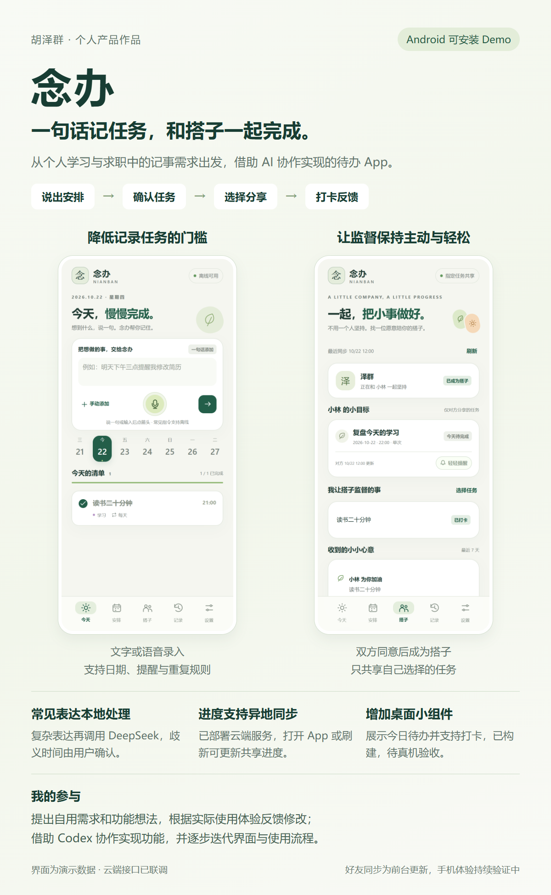

# 念办 Nianban

**一句话记任务，和搭子一起完成。**

从个人学习与求职中的记事需求出发，借助 Codex 协作实现的 Android 待办 Demo。文字或语音输入一句话，识别任务、日期、时刻和重复规则；用户可以编辑、撤销、打卡，并将指定任务交给熟悉的朋友关注。

[查看作品展示页](https://benign120.github.io/nianban/) · [下载 Android APK](https://github.com/benign120/nianban/releases/download/v0.6.0/nianban-0.6.0.apk) · [阅读五页产品作品集](docs/assets/nianban-portfolio.pdf)



## 产品做了什么

- **一句话创建待办**：支持文字与离线中文语音输入。常见明确表达由本地规则处理，复杂表达通过手机 HTTPS 调用 DeepSeek。
- **保留用户确认和纠错能力**：歧义时间补充确认；只有日期时不编造提醒时刻；支持编辑、撤销与理解记录。
- **好友监督**：邀请码申请、双方确认关系，只共享自己选中的任务；查看打卡进度，送出提醒或鼓励。
- **桌面小组件**：展示今日清单和完成数量，支持打卡与进入记事界面。
- **可选微信入口**：电脑接收微信文字任务，手机在同一局域网拉取。与好友云同步是两条独立链路。

## 我的参与与 AI 协作

我提出个人使用需求、功能想法与使用反馈，借助 Codex 推进实现，并在实际使用中提出界面和流程修改。代码实现、接口接入及自动化联调由 AI 协作完成；不将这些工作表述为个人独立手写，也不将个人体验当作大规模用户研究。

## 架构

```text
手机个人任务：文字/语音 → 本地解析或 DeepSeek → 校验/确认 → 本地保存 → Android 提醒

好友协作：手机 A/B → HTTPS 网关 → Node.js 云函数 → 私有文档数据库
                         校验设备身份、搭子关系和允许共享的字段

桌面小组件：读取本地任务 → 打卡写入本地 → 下次打开 App 联网后更新共享进度
```

技术：Android Java、WebView（HTML/CSS/JavaScript）、Vosk 离线中文识别、DeepSeek API、Android Keystore、腾讯云开发 CloudBase。

## 当前状态与边界

当前为 **0.6.0 个人内测 Demo**，未上架应用商店，没有规模用户、留存或商业化数据。

- 已交付可安装 APK；搭子服务已部署，真实 HTTPS 接口联调通过。
- 新版好友在打开 App、返回 App、手动刷新以及前台每分钟更新；没有关闭 App 后的即时推送。
- 每人一位搭子，最多分享 10 项任务。未选任务、原话、录音和模型密钥不通过搭子服务上传。
- 取消分享或结束关系需要联网，对方离线缓存要到下次同步才更新。
- 好友设备身份暂无换机找回；卸载或清除数据会丢失身份。本项目升级请覆盖安装。
- 桌面小组件的日期与状态逻辑已经测试；两部手机异地使用、不同桌面启动器、锁屏及重启后的提醒送达仍需实测。
- 预编译 APK 附带开发者的有限内测服务地址，服务使用免费开发测试环境，存在额度、有效期及可用性限制，不承诺持续在线。源码不附带该环境的管理凭据。

详见 [使用说明](docs/usage.md)、[验证范围](docs/verification.md) 和 [构建说明](docs/development.md)。

## 源码结构

| 目录 | 内容 |
| --- | --- |
| `web/` | 移动端交互、任务状态、本地解析和原生桥调用 |
| `android/` | Android 容器、密钥保管、提醒、语音和桌面小组件 |
| `buddy/` | CloudBase 搭子业务逻辑、身份与共享规则 |
| `weixin/` | 可选电脑微信接入 |
| `tests/` | 规则、状态、接口及原生逻辑测试 |
| `docs/` | GitHub Pages 展示页、海报、产品介绍和说明 |

## 开发验证

Node.js 24 或更高版本：

```bash
npm test
```

这些测试使用独立数据，不能替代手机通知和桌面实测。自行部署搭子函数，请阅读 [部署说明](buddy/README.md)，并填写自己的 HTTPS 地址。

## 第三方组件

Vosk、语音模型、JNA 等组件来源及许可见 [第三方声明](web/THIRD_PARTY_NOTICES.txt)。预编译 APK 保留相应许可声明。DeepSeek 是用户自行配置密钥使用的远程服务。

项目尚未另行指定源码许可证；第三方组件继续遵循各自许可。仓库仅包含整理后的代码与演示资料，不包含个人任务、API Key、微信授权或 APK 签名私钥。
